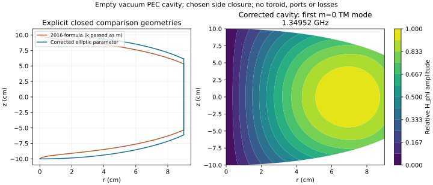

# Maxwell audit of the toroid-excited cavity proposal

**Česky:** Původní návrh z roku 2016 skutečně numericky hledá profil dutiny
buzené toroidem. Obsahuje ale záměnu modulu a parametru eliptických integrálů.
Níže opravujeme profil a poprvé v tomto repozitáři počítáme vlastní Maxwellovy
módy z explicitních vodivých hranic. Výsledek je ověřen na analytickém řešení
válce a zjemňováním sítě. Pro jednu konkrétní uzavřenou prázdnou dutinu vycházejí
první čtyři osově souměrné TM módy přibližně na 1.3495, 1.7142, 2.3337 a
2.8944 GHz. Výpočet neobsahuje skutečný toroid, přívody ani ztráty; neurčuje
buzení a nedokazuje výrobu fyzikálního skalárního pole G.

## 1. Historical input and the elliptic-integral error

The inspected source is David Jaroš's
[wxMaxima file at commit 9f4e22c](https://github.com/DavJ/research/blob/9f4e22c83aabe5a8e54ff47c52e58c46b6986de3/A-field-cavity/num-sol.wxm)
(19 March 2016, Git history). The source blob is
`05502f897f749f25b6ff6a78d064195fe2cd8586`. This audit and its eigenmode
calculations are new work; they must not be attributed to the historical file.

That file computes Az using complete elliptic integrals and solves

```math
F(r,Z)=\int_0^Z A_z(r,z)\,dz=C,
\qquad C=F(0,Z_0).
```

It passes `k=2*sqrt(r*R)/sqrt(z^2+(r+R)^2)` to Maxima's `elliptic_kc` and
`elliptic_ec`. These functions take the **parameter m=k^2**, as do SciPy's
`ellipk` and `ellipe`. See the [official Maxima definitions](https://maxima.sourceforge.io/docs/manual/Elliptic-Functions.html)
and the [Maxima 5.17.1 manual](https://maths.cnam.fr/Membres/wilk/MathMax/help/Maxima/maxima_17.html),
which documents the same convention before 2016.

`cavity_profile.historical_az` reproduces the expression as written, without
silently fixing it. The corrected profile uses the independently tested
`ThinToroidPotential`. For flux Phi and ring radius R its on-axis integral is

```math
C=\frac{\Phi Z_0}{2\sqrt{R^2+Z_0^2}}.
```

An overall nonzero flux normalization cancels from the profile equation.
For R=Z0=0.1 m the reconstructed upper heights are:

| r (cm) | Literal 2016 Z (cm) | Corrected Z (cm) |
|---:|---:|---:|
| 0 | 10.0000 | 10.0000 |
| 2.5 | 8.9558 | 9.7626 |
| 5.0 | 8.0868 | 9.0090 |
| 7.5 | 6.6847 | 7.5635 |
| 9.0 | 5.3334 | 6.1247 |

Tests integrate the flux-ring kernel directly over its angle and over z;
they do not only compare two implementations of elliptic integrals.

## 2. The open integral is a geometry recipe, not a resonance condition

Under A'=A+grad(chi),

```math
F'(r,Z)=F(r,Z)+\chi(r,Z)-\chi(r,0).
```

Take the smooth static function

```math
\chi(r,z)=0.2\Phi (r/R)^2(z/R)
\exp[-(r^2+z^2)/(2R^2)].
```

It vanishes on the axis and at infinity. It therefore leaves the reference C
unchanged but changes the off-axis level curve. At r=0.9R, solving the same
level condition changes Z/R from 0.612469 to 0.410524, while E and B do not
change at all. This is a change of representation, not an adjustable coil.

A chosen-gauge profile can still be a useful engineering heuristic. Its
gauge dependence alone does not prove that a fabricated cavity is useless.
However, the open A integral is neither a gauge-independent voltage nor a
Maxwell eigenmode condition. With a specified stationary path, the physical
electric integral is instead

```math
\int_a^b\mathbf E\cdot d\boldsymbol\ell
=-[\phi(b)-\phi(a)]-\partial_t\int_a^b\mathbf A\cdot d\boldsymbol\ell.
```

Both terms must be retained when changing gauge. Moreover a conducting wall
and its charges/currents change the field relative to the free-space source.

## 3. Explicit physical eigenproblem

The original STL in this repository is an **open meridional trace**, and is
not the same construction as the wxMaxima level curve. Neither supplies a
unique closed cavity. For a reproducible comparison we choose:

- A vacuum meridian 0 <= r <= 0.09 m, -Z(r) <= z <= Z(r).
- R=Z0=0.1 m in the single-toroid integral profile above; reflect its upper
  curve about z=0 and close it by a cylindrical side wall at r=0.09 m.
- Perfect electric conductor (PEC) on every physical wall; the axis is a
  regularity condition, not a metal wall.
- The axisymmetric sector H=H_phi(r,z)e_phi, E=(Er,0,Ez), with exp(-i omega t).
  These are the m=0 modes TM to the z axis. Other azimuthal indices and the
  complementary E_phi sector are outside this calculation.

The reference toroid at r=R,z=0 lies **outside** this chosen closed domain.
It is only a recipe for its shape. No source, hole, dielectric, core or feed
is included in the eigenproblem. A completely closed ideal PEC shell cannot
be driven through its wall by an external coil at nonzero frequency.
Actual excitation needs a specified feed/aperture or internal source and
its material model. The calculation does not claim a coupling efficiency.

Maxwell's equations give

```math
\mathbf E=\frac{i}{\omega\epsilon_0}\nabla\times\mathbf H,
\qquad \mathbf n\times\mathbf E=0.
```

Set H_phi=r*w to enforce regularity at r=0. Then

```math
(\nabla\times\mathbf H)_r=-r\partial_z w,
\qquad(\nabla\times\mathbf H)_z=2w+r\partial_r w.
```

On a metal wall the electric boundary condition becomes

```math
n_r(2w+r\partial_r w)+n_z r\partial_z w=0,
```

equivalently d_n(r H_phi)=0. It is **not** d_n(H_phi)=0. The weak eigenproblem is

```math
\int_\Omega r\left[(2w+r w_r)(2v+r v_r)+r^2w_zv_z\right]dr\,dz
=k^2\int_\Omega r^3wv\,dr\,dz,
\qquad f=\frac{c k}{2\pi}.
```

The common azimuthal factor 2*pi cancels. `cavity_modes` discretizes this
positive Maxwell energy form using bilinear isoparametric quadrilaterals
and three-point Gauss quadrature in each direction. All coordinates are
normalized by the outer radius internally; physical lengths are in metres.
No vector potential, scalar-Laplacian replacement or new G term is used.

## 4. Verification and numerical results

For a cylinder of radius a and full length L the independent reference is

```math
f_{0np}=\frac{c}{2\pi}
\sqrt{(j_{0n}/a)^2+(p\pi/L)^2},\qquad n\ge1,\ p\ge0,
```

where j_0n are zeros of J0. See Fitzpatrick's
[cylindrical cavity derivation](https://farside.ph.utexas.edu/teaching/jk1/Electromagnetism/node116.html).
For a=0.1 m, L=0.2 m, a 64x128 mesh has a maximum relative frequency error
of 0.0203% over the first **six m=0 TM** modes; the fundamental error is
1.07 parts per million. The test also checks the independent J1 magnetic
field shape. Frequencies scale inversely when every length is scaled.

A separate curved-wall control approaches a spherical cavity of radius
0.1 m. Its electric dipole mode has d_x[x*j1(x)]=0, ka=2.74370727 and
f=1.30911744 GHz, using the spherical Bessel function j1. See the
[ITMO electrodynamics notes, equation (3.44)](https://physics.itmo.ru/sites/default/files/courses/additional_documents/lecturenotes0.pdf).
The meridian uses Z(r)=sqrt(a^2-r^2), closed at r=a*(1-1/(4*nr^2)) to avoid a
zero-height cell. Both that equatorial truncation and the mesh spacing tend
to zero. The frequency error relative to the full sphere falls from 0.573%
at 16x32 to 0.0946% at 64x128 and 0.0360% at 128x256. This checks the
sloping-wall condition independently of the cylinder; it includes geometry
approximation and must not be described as an exact spherical mesh.

The chosen profile geometries give the following 96x192-mesh results.
Numbers describe empty-cavity natural frequencies, not measured resonances
or the amplitude under an applied drive:

| Ordered m=0 TM mode | Literal-2016 profile (GHz) | Corrected profile (GHz) |
|---:|---:|---:|
| 1 | 1.36083 | 1.34952 |
| 2 | 1.79914 | 1.71424 |
| 3 | 2.50823 | 2.33370 |
| 4 | 3.00206 | 2.89437 |

The last refinement from 48x96 to 96x192 changes the corrected frequencies
by 0.00163%, 0.00572%, 0.0152% and 0.0298%, respectively. These are observed
mesh changes, **not certified error bounds**. Three- versus five-point
quadrature at 24x48 changes the four frequencies by less than 9e-11 relative.
Algebraic eigenpair residuals and the expected electric/magnetic energy
balance are recorded separately; they are not estimates of discretization
error or independent experimental evidence.



The [machine-readable report](results/cavity-audit.json) includes all meshes,
the literal source URL, dimensional assumptions, gauge control and library
versions. No loss model is supplied, so no Q, linewidth or input-power
requirement is predicted. Loading by cores, leads, dielectrics and feed ports
could change these frequencies substantially.

## 5. A measurable low-frequency reference

The [driven transfer model](toroid-transfer.md) extends this prescribed-current
reference to a finite-impedance source and loaded pickup, including ordinary
capacitive feedthrough and opposed-pair controls. It remains separate from
the empty-cavity eigenproblem above.

For a separate quasistatic reference, an ideal continuously wound rectangular
toroidal solenoid gives, by Ampere's law,

```math
B_\phi(r)=\frac{\mu N I}{2\pi r},
\quad \Phi=\frac{\mu N I h}{2\pi}\ln(b/a),
\quad |\mathcal E|_{\rm peak}=2\pi f N_p\Phi_{\rm peak}.
```

Here a,b are inner/outer radii, h is the axial cross-section height, and the
N_p-turn pickup must **link the toroidal core flux**. Merely placing a loop
in the toroid's central hole does not ensure this linking. The voltage is
ordinary Faraday induction, independent of the gauge used for A.

For a=9 cm, b=11 cm, h=1 cm, air/vacuum core, N=100 and I_peak=0.1 A at
10 kHz, Phi_peak is 4.0134 nWb and the one-turn pickup emf is **0.25217 mV
peak**. This is an illustrative ideal baseline, not a component specification
or a prediction of the closed GHz cavity above. Finite windings, leads,
stray capacitance, source impedance and probe loading are omitted.
An ordinary LC resonance of the drive/pickup would also be distinct from
the calculated empty-cavity modes.

A useful first measurement compares an unlinked control pickup, a pickup
linking one driven toroid, and one linking both oppositely driven toroids.
For equal opposite core fluxes the last pickup's ideal net flux cancels.
Any residual must be compared with measured mismatch, ordinary E/B leakage,
direct capacitive pickup and the instrument's uncertainty. A residual alone
does not identify a new scalar field.

## 6. Gate for an extension or UBT prediction

The standard Maxwell modes above can be represented in Lorenz gauge with
G=c^-2*d_t(phi)+div(A)=0. An axial electric component inside a cavity is not
evidence for an additional independent vacuum polarization.

In the extended AB model used by Minotti and Modanese (2023), at their
lambda=1 choice, Box(G)=mu0*I with I=d_t(rho)+div(J). With conserved total
current, zero scalar initial data and no incoming scalar wave there is no
forced G signal. Surface charge and the complete feed current must be
included in this continuity statement. Homogeneous scalar solutions are
not ruled out by I=0 alone. Their proposed gauge waves have G=0 and need
hypothetical anomalous detector coupling; see [sections I.1, I.5 and I.6](https://arxiv.org/html/2310.13968v1).

This AB extension is not being adopted as a derived UBT action. The
[existing scalar-G audit](https://github.com/DavJ/research/tree/master/audits/scalar_g)
also records an energy discrepancy and an unbounded Hamiltonian for its
explicit unrestricted single-vector quadratic ansatz. It is not a no-go
theorem for all UBT completions. A physical scalar prediction still needs
an action-derived physical mode, constraints and acceptable energy, a
source coupling, a detector coupling, and a numerical observable that
differs from this Maxwell baseline. Adding an adjustable G term does not
derive those ingredients from the single-Theta theory.

## Reproduce

```sh
python -m pip install -e ".[test,report]"
python -m pytest
antihemholtz-cavity
antihemholtz-cavity --profile cylinder --outer-radius 0.1
antihemholtz-cavity --profile historical --radial-cells 48 --axial-cells 96
python scripts/cavity_audit.py --plot
```

The default CLI uses the corrected profile with a 24x48 mesh. The committed
report uses finer meshes. The plotting dependency is optional; the solver
requires only the existing NumPy/SciPy dependencies.
