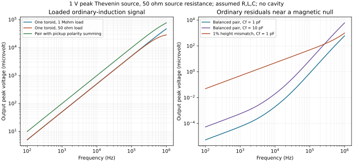

# Driven toroid to pickup-voltage baseline

**Česky:** Máme výpočet přenosu z napětí generátoru přes proud toroidem až k
napětí snímacího vinutí, včetně zatížení a kapacitního přeslechu. Pro níže
uvedené předpokládané součástky dává zdroj 1 V špičkově s odporem 50 ohmů
při 10 kHz přibližně 19.78 mA do primárního vinutí a 0.49885 mV na
desetizávitovém snímači. Vyvážená opačně buzená dvojice ruší magnetický
příspěvek; samotná 1% odchylka výšky druhého toroidu ale vytvoří asi 4.935 uV.
Jde o standardní indukci a obvodové přeslechy. Hodnoty R,L,C nejsou měřené,
rozptylová pole skutečných závitů a přívodů dosud nejsou spočítaná.

## 1. Geometry, observable and scope

This is a **quasistatic bench experiment without a closed conducting cavity**.
It is separate from the [empty GHz cavity eigenproblem](cavity-audit.md).
Its observable is complex terminal voltage V2 relative to the source and/or
the primary winding current I1. Neither an open A integral nor div(A) is used
as a voltage. The pickup must wind around the toroid's **small cross-section**
and link its circumferential flux; an axial loop in the central hole is a
different flux-linking geometry.

For a rectangular cross-section of inner radius a, outer radius b and axial
height h, the continuous-primary-winding approximation gives

```math
B_\varphi(r)=\frac{\mu N I_1}{2\pi r},
\quad P=\frac{\mu h}{2\pi}\ln(b/a),
\quad \Phi=P N I_1,
\quad L_1=P N^2,
\quad M=P N N_p.
```

Here mu=mu0*mu_r, Phi is **single cross-section flux**, and Np is the signed
number of linked pickup turns. This integrates the full finite cross-section,
without substituting a mean r into 1/r. It still approximates the primary by
a uniform continuous winding and ignores its external discrete-turn field.
See [MIT 8.02, chapter 11, example 11.3](https://ocw.mit.edu/courses/8-02t-electricity-and-magnetism-spring-2005/5039d9b38e0e96be41771c5455731e34_chap11inductance.pdf).
The magnetic energy is also checked by independently integrating B^2/(2*mu).

The model uses constant linear inductances, resistances and capacitances.
Actual winding/lead geometry, skin/proximity loss, inter-turn voltage
distributions, radiation, and dispersive or nonlinear ferromagnetic cores
are not solved. The reference mu_r=1 avoids claiming a ferrite material model.
The calculated sweep from 100 Hz to 1 MHz is **not a measured or validated
hardware bandwidth**. The cavity's GHz resonances are not used to amplify it.

## 2. Circuit with loading, backreaction and a capacitive path

Use peak-amplitude phasors with exp(+i*omega*t), unlike the exp(-i*omega*t)
convention of the cavity solver. Winding currents I1,I2 enter their dotted
terminals; terminal voltages V1,V2 are measured from dot to common return.

- A Thevenin source Vg drives V1 through Rs.
- The primary winding has series R1,L1; Cp shunts V1 to return.
- The pickup winding has series R2,L2 and mutual inductance M with the primary.
- The instrument presents RL in parallel with CL at V2. A missing resistive
  load is represented by RL=None; CL can still load that port.
- Cf joins V1 to V2 and models one explicit ordinary capacitive feedthrough.
  It does not represent every possible lead, ground or probe artefact.

With Z1=R1+i*omega*L1, Z2=R2+i*omega*L2, Yp=i*omega*Cp,
YL=1/RL+i*omega*CL and Yf=i*omega*Cf, solve

```math
V_1=Z_1 I_1+i\omega M I_2,
\qquad V_2=i\omega M I_1+Z_2 I_2,
```

```math
(V_g-V_1)/R_s=I_1+Y_pV_1+Y_f(V_1-V_2),
\qquad 0=I_2+Y_LV_2+Y_f(V_2-V_1).
```

The pickup current therefore acts back on the primary. It is not computed
after holding the primary current artificially fixed. With Cf=0 an
independent closed form is available:

```math
Z_L=Y_L^{-1},\quad
Z_e=Z_1+\frac{\omega^2 M^2}{Z_2+Z_L},
\quad I_1=\frac{V_g}{R_s+(1+R_sY_p)Z_e},
\quad V_2=\frac{i\omega M Z_L}{Z_2+Z_L}I_1.
```

This is checked independently against the four-equation implementation.
For a completely open pickup with Cf=0, V2=i*omega*M*I1. The emf around an
oriented contour has the corresponding Faraday minus sign; terminal polarity
here follows the passive dot convention.

## 3. Energy and numerical checks

The instantaneous magnetic energy of the lumped model is

```math
W_m=\tfrac12 L_1 i_1^2+M i_1i_2+\tfrac12 L_2 i_2^2.
```

The code rejects |M|>sqrt(L1*L2), so this form is positive semidefinite.
The electric energy is

```math
W_e=\tfrac12 C_p v_1^2+\tfrac12 C_Lv_2^2+\tfrac12 C_f(v_1-v_2)^2.
```

All capacitances/resistances must be nonnegative, with strictly positive
Rs and finite positive RL when present. At nonzero frequency the average
power must satisfy

```math
\tfrac12\operatorname{Re}(V_gI_s^*)=
\tfrac12[R_s|I_s|^2+R_1|I_1|^2+R_2|I_2|^2+|V_2|^2/R_L].
```

The DC calculation uses real sources and V*I instead of the sinusoidal
factor 1/2. Tests cover magnetic reciprocity, reversed dot polarity,
the independent loaded-transfer formula, DC and open-pickup limits,
linear amplitude scaling, passive power balance, magnetic cancellation
and surviving capacitive feedthrough. Source current is evaluated by
terminal KCL to avoid subtracting nearly equal voltages near antiresonance.

## 4. Explicit illustrative component values

These are model inputs, **not measured properties of a built device**:

| Quantity | Single-toroid reference |
|---|---:|
| a, b, h | 9 cm, 11 cm, 1 cm |
| Primary turns N; pickup turns Np | 100; 10 |
| Relative permeability | 1 |
| Geometric L1 | 4.01341 uH |
| Geometric linked M | 0.401341 uH |
| Assumed pickup self-inductance L2 | 10 uH |
| Assumed winding resistances R1, R2 | 0.55 ohm, 0.20 ohm |
| Source Vg, Rs | 1 V peak open-circuit; 50 ohm |
| Instrument RL, CL | 1 Mohm; 100 pF |
| Primary Cp; feedthrough Cf | 50 pF; 1 pF |

L2 includes pickup leakage flux and must be independently measured or
computed for an actual winding. It is not set equal to only the toroidal
core contribution P*Np^2. The same applies to the assumed R and C values.
Vg is the Thevenin **open-circuit** source voltage; a generator display
calibrated for a 50-ohm load can use a different amplitude convention.

Pair cases use two series-opposed primaries and two local series pickups.
They assume negligible cross-core coupling. Their aggregate L1,L2,R1,R2
are the sums of both branches; Cp,Cf,CL remain explicit assumed aggregate
capacitances, not derived series reductions of individual winding capacitors.

| Configuration | M effective | Output peak at 10 kHz |
|---|---:|---:|
| One linked toroid/pickup | M | 498.849 uV |
| Balanced opposed pair, Cf=0 | 0 | 0 |
| Balanced opposed pair, Cf=1 pF | 0 | 0.001962 uV |
| Second toroid h increased by 1%, Cf=1 pF | -0.01 M | 4.93488 uV |
| One pickup reversed so the pair sums | 2 M | 986.928 uV |

The single-toroid winding current is 19.7822 mA peak. These voltages are not
directly proportional to M across all rows because source and pickup
impedances differ in the series pair. Normalize by the actual winding
current and the independently characterized pickup transfer when comparing
couplings. Port/source current also contains capacitive currents and is
not automatically the winding current I1.

At 1 MHz, the assumed 1-pF feedthrough alone gives about 0.608 mV in the
balanced pair, despite its exact magnetic M=0. This is an ordinary
background of this circuit model. It is not evidence for a scalar field,
and is not a bound on all backgrounds of an actual apparatus.



All complex sweep results, component assumptions and power checks are in
the [JSON report](results/toroid-transfer.json). The plot omits the identically
zero Cf=0 balanced curve because zero cannot appear on a logarithmic axis.

## 5. Geometry uncertainty matters before claiming a residual

For exact turn counts and mu, first-order uncertainty in M=P*N*Np is

```math
\frac{\delta M}{M}=\frac{\delta h}{h}
+\frac{\delta b/b-\delta a/a}{\ln(b/a)}.
```

As an illustration only, let each of a,b,h have an independent **one-sigma
uncertainty of 0.1 mm** on each toroid. Then sigma(M)/M is 1.230% per
toroid and sigma(M1-M2) is 6.979 nH for the pair. Linear propagation through
the loaded circuit at 10 kHz gives an 8.58 uV standard uncertainty contribution
to the complex output. This is neither a measured noise floor nor a total
error budget or anomaly threshold. Correlated errors change the result;
independent calibration can constrain the net coupling more precisely than
dimensions alone.

The 1% mismatch example is therefore a useful ordinary-induction control,
not a prediction that a fabricated pair will cancel to nanovolts. The small
capacitive residual in the ideal balanced model must not be presented as
an achievable experimental sensitivity.

## 6. Measurement sequence and the remaining physical work

1. Start with one air-core toroid and a local linked pickup, without the
   closed conducting cavity. Characterize the actual R,L,C versus frequency,
   generator voltage convention and the instrument/cable impedance.
2. Measure complex V2 and winding I1 over a modest initial range such as
   1-100 kHz, rather than using the empty-cavity GHz eigenfrequency. A winding
   current shunt adds branch resistance and must be included in R1; its
   placement must distinguish I1 from capacitive port currents.
3. Reverse magnetic pickup polarity and compare linked/unlinked controls
   with matched lead placement. With no feedthrough the magnetic response
   changes sign exactly. With both paths present they interfere as complex
   voltages; magnitudes cannot simply be subtracted.
4. Drive the pair in series opposition and measure each pickup contribution
   before forming their sum/null. Then deliberately reverse one pickup or
   introduce a known mismatch as an induction control.
5. Independently characterize cross-core mutual inductances and the complete
   capacitance network. For a real pair the exact reduction is
   Lp=s_p^T*Lpp*s_p, Ls=s_s^T*Lss*s_s, M=s_p^T*Lps*s_s, with winding sign
   vectors s_p,s_s. The simple reference builder sets cross-core terms to zero.
   Capacitances to internal series nodes need a larger nodal circuit.
6. Compare data with independently calibrated uncertainties, lead/field
   leakage and instrument noise. This report contains no measured data,
   completed discrete-winding field calculation or full radiation model.

A departure from this simplified model is initially a model discrepancy.
Identifying a new scalar coupling still requires a theory-derived source
and detector prediction that survives these ordinary controls; it cannot
be inferred from a nonzero residual alone.

## Reproduce

```sh
python -m pip install -e ".[test,report]"
python -m pytest
antihemholtz-transfer
antihemholtz-transfer --scenario balanced-pair --feed-capacitance-pf 0
antihemholtz-transfer --scenario mismatched-pair --frequency 10000
python scripts/transfer_audit.py --plot
```

For arbitrary characterized components, construct `CoupledCircuit` in Python
and call `.response(frequencies_hz, source_peak_v)`. `RectangularToroid`
supplies the finite-cross-section primary L and linked M separately.
